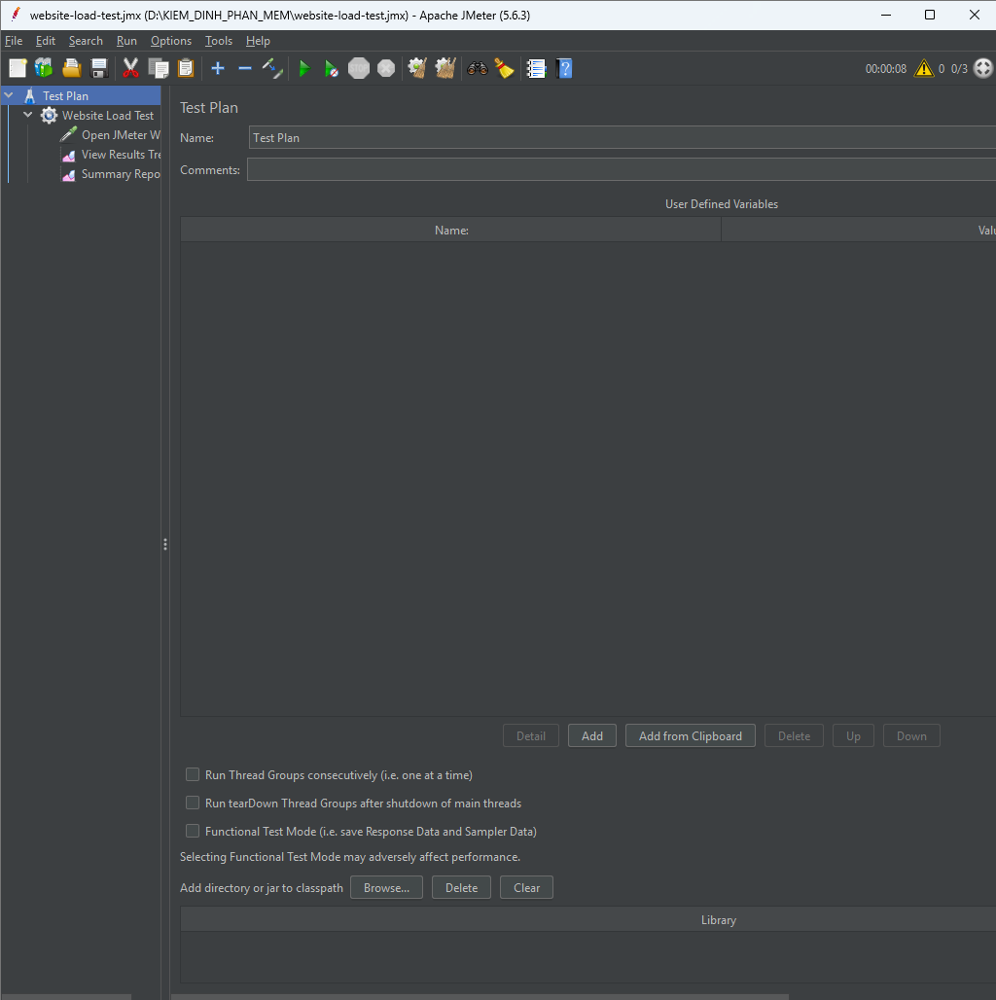
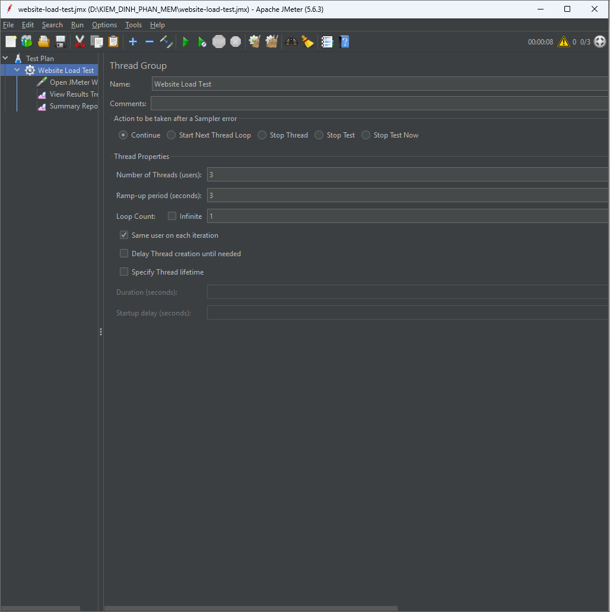
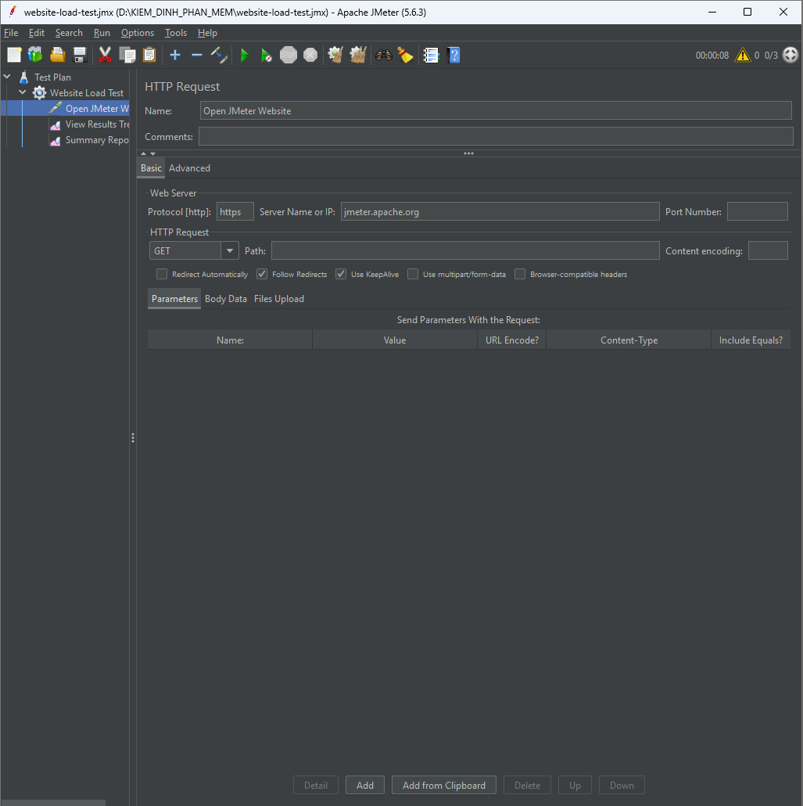
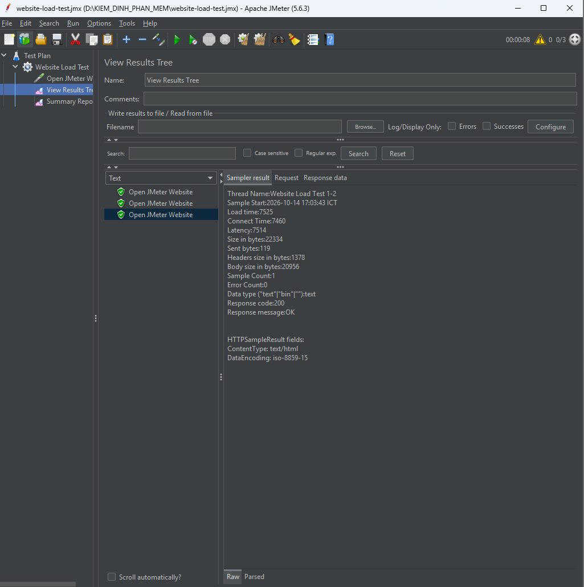
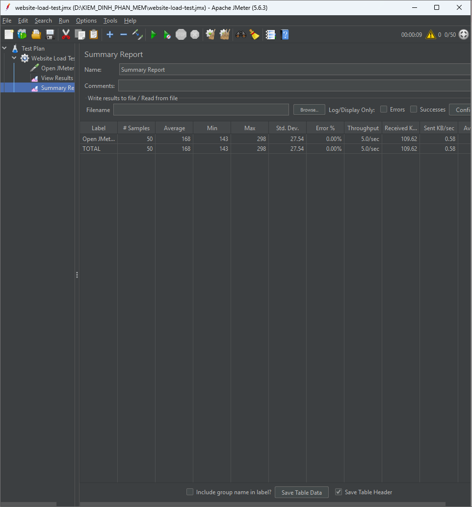

# BÁO CÁO KIỂM THỬ HIỆU NĂNG BẰNG APACHE JMETER

## 1. Giới thiệu

Apache JMeter là công cụ mã nguồn mở được sử dụng để kiểm thử hiệu năng của website và ứng dụng. Công cụ cho phép mô phỏng nhiều người dùng truy cập hệ thống, gửi yêu cầu HTTP và thu thập các thông số như thời gian phản hồi, số lượng yêu cầu, tỷ lệ lỗi và thông lượng.

Trong bài thực hành này, em sử dụng Apache JMeter để kiểm thử hiệu năng website Apache JMeter tại địa chỉ https://jmeter.apache.org/.

## 2. Mục tiêu

- Làm quen với giao diện và cách sử dụng Apache JMeter.
- Xây dựng Test Plan để kiểm thử website bằng HTTP Request.
- Mô phỏng 50 người dùng ảo truy cập website.
- Thu thập và phân tích các chỉ số hiệu năng.
- Sử dụng Git và GitHub để quản lý, lưu trữ bài thực hành và báo cáo.

## 3. Công cụ sử dụng

| Công cụ | Phiên bản hoặc mục đích |
|---|---|
| Apache JMeter | 5.6.3 |
| Java JDK | 21 |
| Visual Studio Code | Chỉnh sửa báo cáo và quản lý dự án |
| Git | Quản lý phiên bản |
| GitHub | Lưu trữ mã nguồn và báo cáo |

## 4. Thiết lập kiểm thử

### 4.1. Cấu hình Thread Group

| Thông số | Giá trị |
|---|---:|
| Number of Threads (Users) | 50 |
| Ramp-up Period | 10 giây |
| Loop Count | 1 |
| Số yêu cầu dự kiến | 50 |

Thread Group được cấu hình với 50 người dùng ảo, thời gian khởi tạo người dùng là 10 giây và mỗi người dùng thực hiện một vòng lặp. Với một HTTP Request trong mỗi vòng lặp, số yêu cầu dự kiến là 50.

### 4.2. Cấu hình HTTP Request

| Thông số | Giá trị |
|---|---|
| Protocol | HTTPS |
| Server Name or IP | jmeter.apache.org |
| Method | GET |
| Path | / |

HTTP Request sử dụng phương thức GET để gửi yêu cầu truy cập trang chủ website.

### 4.3. Các Listener sử dụng

- **View Results Tree:** Hiển thị kết quả từng yêu cầu và thông tin phản hồi từ máy chủ.
- **Summary Report:** Tổng hợp các chỉ số hiệu năng của toàn bộ lần kiểm thử.

## 5. Hình ảnh minh chứng

### 5.1. Tổng quan Test Plan

Hình 1. Cấu trúc Test Plan được xây dựng trong Apache JMeter.

### 5.2. Cấu hình Thread Group

Hình 2. Cấu hình 50 người dùng ảo, Ramp-up Period 10 giây và Loop Count bằng 1.

### 5.3. Cấu hình HTTP Request

Hình 3. Cấu hình yêu cầu GET đến trang chủ website Apache JMeter.

### 5.4. Kết quả từng yêu cầu

Hình 4. Kết quả phản hồi của các yêu cầu trong View Results Tree.

### 5.5. Báo cáo tổng hợp Summary Report

Hình 5. Báo cáo tổng hợp các chỉ số hiệu năng sau khi kiểm thử.

## 6. Kết quả kiểm thử

Bài kiểm thử được thực hiện với 50 người dùng ảo, Ramp-up Period là 10 giây và Loop Count bằng 1. Kết quả được ghi nhận từ Summary Report của Apache JMeter.

| STT | Chỉ số | Kết quả |
|---:|---|---:|
| 1 | Số người dùng ảo (Threads) | 50 |
| 2 | Ramp-up Period | 10 giây |
| 3 | Loop Count | 1 |
| 4 | Tổng số yêu cầu (Samples) | 50 |
| 5 | Thời gian phản hồi trung bình (Average) | 168 ms |
| 6 | Thời gian phản hồi nhỏ nhất (Min) | 143 ms |
| 7 | Thời gian phản hồi lớn nhất (Max) | 298 ms |
| 8 | Độ lệch chuẩn (Standard Deviation) | 27,54 ms |
| 9 | Tỷ lệ lỗi (Error %) | 0,00% |
| 10 | Thông lượng (Throughput) | 5,0 yêu cầu/giây |
| 11 | Dữ liệu nhận (Received KB/sec) | 109,62 KB/s |
| 12 | Dữ liệu gửi (Sent KB/sec) | 0,58 KB/s |

### 6.1. Phân tích kết quả

Kết quả kiểm thử ghi nhận tổng cộng 50 yêu cầu được thực hiện. Thời gian phản hồi trung bình đạt 168 ms, thời gian nhỏ nhất là 143 ms và thời gian lớn nhất là 298 ms. Độ lệch chuẩn là 27,54 ms, cho thấy thời gian phản hồi có sự dao động quanh giá trị trung bình.

Tỷ lệ lỗi đạt 0,00%, nghĩa là không ghi nhận yêu cầu lỗi trong lần kiểm thử này. Thông lượng đạt 5,0 yêu cầu/giây. Tốc độ nhận dữ liệu là 109,62 KB/s và tốc độ gửi dữ liệu là 0,58 KB/s theo số liệu được ghi nhận.

Nhìn chung, website đã phản hồi thành công trong lần kiểm thử với cấu hình đã thiết lập. Tuy nhiên, kết quả chỉ phản ánh điều kiện thử nghiệm tại thời điểm thực hiện và chưa đủ để xác định giới hạn tải tối đa của website.

## 7. Kết luận

Qua bài thực hành, em đã làm quen với Apache JMeter và biết cách xây dựng Test Plan, cấu hình Thread Group, thiết lập HTTP Request và sử dụng các Listener để theo dõi kết quả.

Việc mô phỏng 50 người dùng ảo giúp em thực hành quy trình kiểm thử hiệu năng và phân tích những chỉ số cơ bản như thời gian phản hồi, độ lệch chuẩn, tỷ lệ lỗi và thông lượng. Đồng thời, em đã sử dụng Git và GitHub để lưu trữ báo cáo và hình ảnh minh chứng, thuận tiện cho việc kiểm tra và đánh giá bài thực hành.

## 8. Tài liệu tham khảo

- Apache JMeter: https://jmeter.apache.org/
- Apache JMeter User Manual: https://jmeter.apache.org/usermanual/
- GitHub: https://github.com/

## 9. Repository GitHub

Link dự án: https://github.com/hongtuoi0208/jmeter-performance-testing
